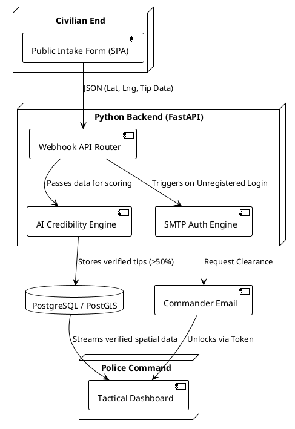
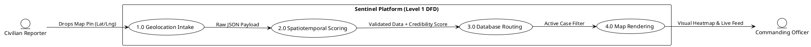
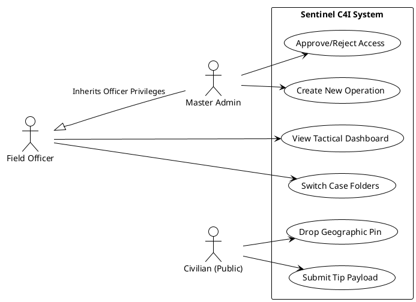

# REPORT VISUALS & DIAGRAMS INTEGRATION GUIDE

To make your report visually striking and score top marks, you need to break up the dense text with Tables and Figures. Below is a detailed guide on exactly what images to take, where to paste them in your Word document, and the **PlantUML code** you can use to instantly generate your required academic diagrams.

---

## 1. THE TABLES (Insert these into your Word Doc)

### Table 1: Literature Survey Comparison Matrix
* **Where to add:** At the very end of **Chapter 2**, right before "SUMMARY OF RESEARCH GAPS".
* **What to build in Word:** Create a 4x4 table that summarizes the papers you discussed so the external examiner can read it at a glance.

| Paper ID | Author & Year | Key Technology | Primary Disadvantage (Lacuna) |
| :--- | :--- | :--- | :--- |
| Paper 1 | Goodchild (2010) | Crowdsourced Web GIS | No AI validation; highly prone to false rumors. |
| Paper 2 | Castillo (2011) | Machine Learning | Limited to Twitter text; no police mapping integration. |
| Paper 3 | Chainey (2013) | Crime Heatmapping | Manual data entry bottleneck; highly siloed. |
| Paper 4 | Ray (2019) | LoRaWAN Hardware | Raw sensor logs; lacks visual web dashboard integration. |

### Table 2: Stage-I Software Test Cases
* **Where to add:** Under **Chapter 4.3 Executed Test Cases (Stage-I)**.
* **What to build in Word:** Convert the text I wrote earlier into this clean testing matrix.

| Test ID | Module Tested | Expected Outcome | Actual Outcome | Status |
| :--- | :--- | :--- | :--- | :--- |
| TC-01 | Civilian Map UI | Generate accurate 6-decimal Lat/Lng coordinates on map click. | Coordinates generated with zero latency. | **PASS** |
| TC-02 | Auth Webhook | Unregistered login triggers `[QUARANTINE]` and sends SMTP email. | UI blocked access; Admin received email in 1.5s. | **PASS** |
| TC-03 | Admin Rejection | Admin clicking "REJECT" permanently locks the officer profile. | JavaScript route-guard enforced `[CLEARANCE DENIED]`. | **PASS** |
| TC-04 | Case Segregation | Clicking a folder dynamically hot-swaps the Subject Profile UI. | Event listener successfully updated DOM profile data. | **PASS** |

---

## 2. THE UI SCREENSHOTS (Take these yourself)

**Figure 1: The Public Tip Intake Portal**
* **Where to add:** Under **Chapter 1.3 Proposed System**.
* **Action:** Open `submit_tip.html` in your browser. Take a screenshot showing the dark-mode form and the Esri Map with a red pin dropped on it. Add a caption below the image: *Figure 1: The Asymmetric Public Intake Portal with integrated GIS mapping.*

**Figure 2: The Tactical Command Dashboard**
* **Where to add:** Under **Chapter 3.4 Present Report on Investigation**.
* **Action:** Open `dashboard.html` in your browser. Make sure you click a folder so the map and live feed look active. Take a fullscreen screenshot. Add a caption: *Figure 2: The highly secure, Leaflet-powered Officer Command Dashboard.*

**Figure 3: Zero-Trust Authentication Protocol**
* **Where to add:** Under **Chapter 5.3 Backend Procedure & Tools**.
* **Action:** Take a screenshot of the red `[QUARANTINE]` error on the login screen, and put it side-by-side with a screenshot of the automated Email received in your Gmail inbox. Caption: *Figure 3: Zero-Trust SMTP Webhook Quarantine state.*

---

## 3. ACADEMIC DIAGRAMS (PlantUML Code)
*How to use: Go to [PlantText.com](https://www.planttext.com/) or [PlantUML Web Server](http://www.plantuml.com/plantuml/uml/). Paste the code blocks below, click Generate, and save the resulting image to paste into your Word document!*

### Diagram 1: System Architecture Workflow
* **Where to add:** Under **Chapter 3.2 Proposed System & Overcoming Current Drawbacks**

### Diagram 2: DFD (Data Flow Diagram - Level 1)
* **Where to add:** Under **Chapter 3.5 A. Data Flow Diagram**

### Diagram 3: UML Use Case Diagram
* **Where to add:** Under **Chapter 3.5 B. UML Use Case Diagram**

