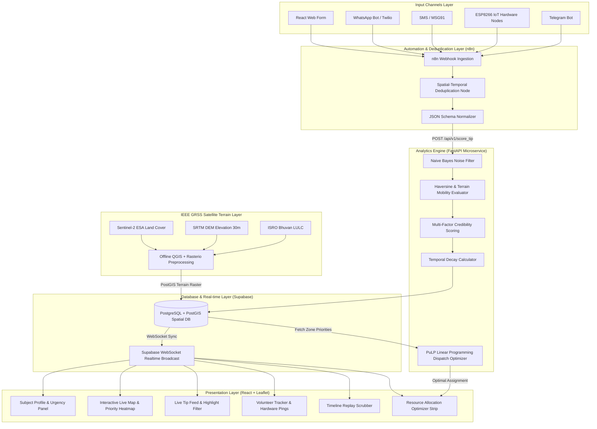

# SENTINEL: System Architecture Specification

## Architecture Overview



---

## Technical Component Specifications

### 1. Ingestion Channels
* **React Web Form**: Direct browser submission with auto-captured HTML5 Geolocation coordinates and image attachment upload.
* **WhatsApp / SMS (Twilio & MSG91)**: Ingests unstructured text messages and location attachments, sending JSON payloads directly to n8n webhooks.
* **Hardware IoT Nodes**: ESP8266 + NEO-6M GPS modules broadcasting `$GPRMC` NMEA data converted to lat/lng JSON payloads every 60 seconds over Wi-Fi/Hotspot.

### 2. Automation & Deduplication (n8n Engine)
* **Rule**: Incoming tips checked against database records within a **200m spatial radius** and **30-minute temporal window**.
* **Match Found**: Tip appended as corroborating sighting to root lead. Increments corroboration count $N_{\text{corrob}}$, tightening score confidence interval.
* **No Match**: Tip treated as new lead and pushed to FastAPI scoring endpoint.

### 3. Database Schema (PostgreSQL + PostGIS)

#### Table: `incidents`
```sql
CREATE TABLE incidents (
    id UUID PRIMARY KEY DEFAULT gen_random_uuid(),
    subject_name VARCHAR(100) NOT NULL,
    age INT,
    lkp_latitude DOUBLE PRECISION NOT NULL,
    lkp_longitude DOUBLE PRECISION NOT NULL,
    lkp_time TIMESTAMPTZ NOT NULL,
    medical_flag VARCHAR(255),
    clothing_description TEXT,
    created_at TIMESTAMPTZ DEFAULT NOW()
);
```

#### Table: `tips`
```sql
CREATE TABLE tips (
    id UUID PRIMARY KEY DEFAULT gen_random_uuid(),
    incident_id UUID REFERENCES incidents(id),
    source_type VARCHAR(20) CHECK (source_type IN ('responder', 'volunteer', 'public_verified', 'anonymous')),
    raw_text TEXT,
    latitude DOUBLE PRECISION NOT NULL,
    longitude DOUBLE PRECISION NOT NULL,
    location_geom GEOMETRY(Point, 4326),
    observation_time TIMESTAMPTZ NOT NULL,
    score DOUBLE PRECISION,
    priority VARCHAR(10) CHECK (priority IN ('CRITICAL', 'MEDIUM', 'LOW')),
    is_noise BOOLEAN DEFAULT FALSE,
    corroboration_count INT DEFAULT 1,
    confidence_lower INT,
    confidence_upper INT,
    created_at TIMESTAMPTZ DEFAULT NOW()
);

CREATE INDEX idx_tips_geom ON tips USING GIST (location_geom);
```

#### Table: `volunteer_nodes`
```sql
CREATE TABLE volunteer_nodes (
    node_id VARCHAR(50) PRIMARY KEY,
    unit_label VARCHAR(50),
    latitude DOUBLE PRECISION NOT NULL,
    longitude DOUBLE PRECISION NOT NULL,
    battery_level INT,
    last_ping TIMESTAMPTZ DEFAULT NOW()
);
```

---

## Real-Time Synchronization Flow
1. FastAPI computes score and writes record to Supabase `tips` table.
2. PostgreSQL trigger fires a Supabase `REALTIME` WebSocket event.
3. React Command Dashboard receives JSON payload via active WebSocket connection in `< 1000ms`.
4. Leaflet map dynamically inserts/updates color-coded marker (Red = 70+, Amber = 35–69, Grey = <35).
