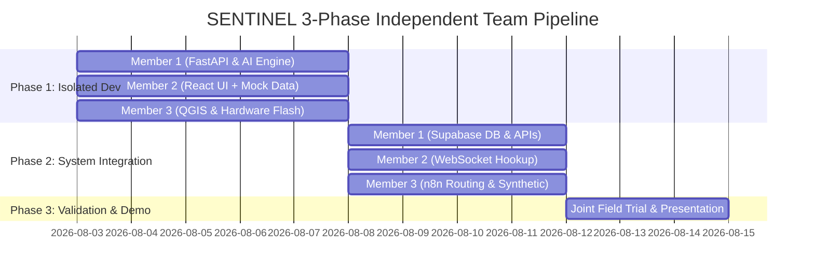

# SENTINEL - Team Task Allocation & Implementation Plan

## Executive Team Allocation & Skill Alignment

To ensure equal contribution, maximum independence, and smooth integration, SENTINEL is divided into **3 parallel streams** tailored to team members' skill levels:

```
                  +----------------------------------------------+
                  |            SENTINEL INTEGRATED PLATFORM      |
                  +----------------------------------------------+
                                         |
     +-----------------------------------+-----------------------------------+
     |                                   |                                   |
     ▼                                   ▼                                   ▼
[MEMBER 1: ADVANCED TECH]        [MEMBER 2: ADVANCED TECH]        [MEMBER 3: ACCESSIBLE TECH]
Backend & Core AI Engine         Frontend & Interactive UI        GIS, Hardware & Documentation
- FastAPI Microservice           - React.js + Vite App            - Sentinel-2 & DEM Satellite Layers
- Mathematical Scoring Formula   - Leaflet Interactive Map        - ESP8266 Hardware GPS Node
- Naive Bayes Classifier         - Real-time Tip Stream           - n8n Automation Workflows
- PuLP Linear Programming        - Subject Profile & Timeline     - Synthetic Dataset & Demo Plan
```

---

## Member Task Breakdown & Skill Matching

### 👤 Member 1 (High Technical Comfort)
**Role**: **Backend Architect & AI Intelligence Lead**  
**Focus**: Algorithms, API Endpoints, Scoring Engine, Database Schema

#### Key Deliverables:
1. **FastAPI Microservice Core**: Setup project architecture, API routes (`/api/v1/score_tip`, `/api/v1/optimize_dispatch`, `/api/v1/hardware_ping`).
2. **Credibility Scoring Matrix Implementation**:
   $$S = (w_1 \cdot C_{\text{source}} + w_2 \cdot V_{\text{spatial}} + w_3 \cdot I_{\text{content}}) \times e^{-\lambda \cdot \Delta t}$$
3. **Naive Bayes Noise Filter**: Train `scikit-learn` Multinomial Naive Bayes classifier on sighting keywords vs noise phrases.
4. **PuLP Resource Allocator**: Formulate and solve the linear programming model for matching volunteer teams to high-priority search zones.
5. **Database Connections & PyTest Unit Tests**: Connect to Supabase PostgreSQL and write PyTest cases for mathematical scoring.

---

### 👤 Member 2 (High Technical Comfort)
**Role**: **Frontend Architect & Command UI Lead**  
**Focus**: User Interface, Interactive Maps, Real-Time WebSockets, Dashboard Polish

#### Key Deliverables:
1. **React + Vite App Setup**: Build command center layout following the tactical dark navy glassmorphic design system (`Design.md`).
2. **Leaflet.js Interactive Map Component**:
   - Priority color-coded markers (Red 70+, Amber 35-69, Grey <35, Cyan Volunteer).
   - Priority heatmap density overlay and convex hull bounding polygon.
3. **Live Tip Feed & Highlight Filter**: Real-time stream with auto-focus map zooming on card click.
4. **Volunteer Tracker & Timeline Scrubber**:
   - Hardware node live status panel.
   - Interactive slider to scrub and replay tip density evolution hour by hour.
5. **Supabase WebSocket Sync**: Connect UI to Supabase Realtime channel for `< 1s` push updates.

---

### 👤 Member 3 (Accessible / Less Technical Comfort)
**Role**: **GIS Satellite, IoT Hardware & Workflow Coordinator**  
**Focus**: Remote Sensing Preprocessing, Hardware Assembly/Flashing, Automation, Testing Data, PPT & Demo Setup

#### Key Deliverables:
1. **IEEE GRSS Satellite Preprocessing (No Heavy Coding Required)**:
   - Download Sentinel-2 land cover geotiff and SRTM DEM elevation tiles for demo area (Navi Mumbai).
   - Process terrain cost raster using **QGIS GUI interface** and export GeoTIFF to PostGIS.
2. **Hardware IoT GPS Field Node Setup**:
   - Physical assembly of NodeMCU ESP8266 + NEO-6M GPS module + 18650 battery + switch on breadboard.
   - Flash pre-written Arduino C++ sketch using **Arduino IDE GUI**.
3. **n8n Automation & Deduplication Workflow**:
   - Build visual n8n workflow nodes for Webhook ingestion, 200m spatial / 30-min temporal deduplication, and routing.
4. **Synthetic Test Dataset & Presentation Prep**:
   - Create 200–300 realistic tip test samples with ground-truth coordinates in Excel/CSV.
   - Prepare project documentation, poster, slides, and live demonstration trial runs.

---

## 3-Phase Independent Execution Pipeline

To eliminate dependencies between team members during development, mock contracts and independent testing interfaces are defined for each phase:



### Phase 1: Zero-Dependency Isolated Development
* **Member 1**: Develops and tests FastAPI scoring algorithms using local JSON test inputs.
* **Member 2**: Develops the React dashboard using a static `mock_tips.json` file so UI development is **100% independent** of backend progress.
* **Member 3**: Assembles hardware node using Arduino IDE and generates satellite geotiff files using QGIS GUI.

### Phase 2: Pipeline Integration & Verification
* **Step 1 (Member 3 to Member 1)**: Member 3 loads synthetic CSV dataset into n8n to test deduplication, then forwards parsed payloads to Member 1's FastAPI endpoint.
* **Step 2 (Member 1 to Member 2)**: Member 1 connects FastAPI output to Supabase DB. Member 2 replaces static `mock_tips.json` with active Supabase WebSocket real-time subscription.
* **Step 3 (Member 3 Hardware to Pipeline)**: Member 3 powers on ESP8266 IoT node to push live GPS coordinates directly into the integrated pipeline.

### Phase 3: Final Testing & Presentation
* Joint validation runs (Precision@K validation, temporal decay test, PuLP solver check, live outdoor hardware tracking demo).
